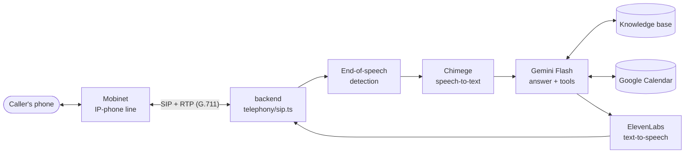

# CallAI — AI phone receptionist for Mongolian businesses

CallAI answers a small business's real phone number in Mongolian. It greets
callers by the business name, answers questions from the business's own
knowledge base, books, checks and cancels reservations on Google Calendar,
and hands the caller over to a person when it cannot help. Owners sign in to a
web dashboard to read call transcripts, see bookings, edit what the AI knows,
and pick the AI's voice.

| | |
| --- | --- |
| Website and dashboard | [callai.world](https://callai.world) |
| Demo phone number | **7515 5562** (call from any Mongolian phone) |
| Backend API | `https://api.callai.world` |

## How a call works



1. The backend registers on Mobinet's SIP server as the phone for the business
   number, so calls arrive directly — no call forwarding and no Twilio.
2. Caller audio (8 kHz μ-law or A-law) is split into utterances by silence
   detection. Breathing and line noise do not interrupt the AI.
3. Each utterance is transcribed by **Chimege**, a Mongolian speech recogniser.
   If Chimege is not configured or fails, the audio goes to Gemini directly.
4. **Gemini Flash** reads the text with the business's instructions and
   knowledge, and calls tools when needed: `check_availability`,
   `create_appointment`, `find_my_bookings`, `cancel_appointment`,
   `request_human`.
5. While the answer is prepared, a short acknowledgement ("За") can play so the
   caller is not left in silence. The reply is spoken by **ElevenLabs**, sped
   up 1.15× without changing pitch, and streamed back over RTP.
6. The call, its transcript, intent and any booking are saved and appear in
   the dashboard.

## Features

**On the phone**

- Natural Mongolian: one question at a time, short confirmations
  ("Баталгаажуулъя: …, Зөв үү?"), suffixes that follow vowel harmony.
- Numbers, prices, times and phone numbers are spoken as words
  ("арван найман мянга", "орой долоо хагаст", "ерэн ес, арван нэг…").
- Answers business questions only from approved knowledge and says so when
  something is not recorded, instead of guessing prices or addresses.
- Restaurant bookings with table capacity (`TABLE_COUNT`, `SEATS_PER_TABLE`);
  if the requested time is full, offers the nearest free time.
- Callers can look up and cancel their own bookings (only for the number they
  call from).
- Hands over to staff with the caller's name and reason.
- Outbound calls over the same SIP line: booking reminders and test calls
  from the dashboard (rate limited).
- Several businesses and SIP numbers on one backend; each number belongs to
  one business and its SIP password is stored encrypted.

**In the dashboard** ([callai.world](https://callai.world))

- Sign up and log in; every page requires a session and shows only the
  signed-in business's data.
- Overview, call history with transcripts, bookings, analytics.
- Knowledge base editor.
- Settings: business name and AI voice (Уянга, Наран, Оюуна, with samples).
- Test call page: the AI calls you.

## Measurements

Recorded by the team on real phone calls; small samples, not a benchmark.

Recognising Mongolian phone speech (one recorded call, five questions):

| Model | Correctly understood |
| --- | --- |
| Gemini Live models (3.8 Live, 3.1 Flash Live, 3.5 Transcribe Live) | 0 / 5 |
| ElevenLabs Scribe | 1 / 5 |
| Gemini 3.6 Flash (audio in) | 3–4 / 5 |

Gemini Flash also invented sentences the caller never said when the audio was
unclear, which is why recognition moved to Chimege.

Latency after the caller stops speaking:

| Step | Before | Now |
| --- | --- | --- |
| Chimege recognition | ~1.8 s | ~0.9 s (connection kept warm) |
| First audio the caller hears | ~2.9 s | ~1.45 s |

The full spoken answer still takes several seconds when Gemini or a calendar
lookup is slow. Gemini Live answered in about a second but understood no
Mongolian phone speech, so the slower turn-based design was chosen for
accuracy.

## Repository layout

npm workspaces with two packages:

```text
backend/                       Node.js + TypeScript server (no framework)
  src/index.ts                 HTTP API, /voice webhook, /media-stream WebSocket, SIP start-up
  src/telephony/
    sip.ts                     SIP registration, incoming/outgoing calls, RTP audio
    lines.ts, addLine.ts       SIP numbers per business (encrypted passwords)
    twilio.ts                  call session: audio in/out, barge-in, speech queue
    reminder.ts                booking reminder calls
    callback.ts                Twilio "call me back" (optional, earlier fallback)
    twilioSignature.ts, streamTokens.ts   Twilio request validation
  src/ai/
    geminiTurns.ts             turn-based listening: utterance detection → Chimege/Gemini
    chimege.ts                 Chimege speech-to-text client
    geminiLive.ts              tool declarations and the older Gemini Live mode
    callPrompt.ts              system instructions per business
    mongolianSuffix.ts         vowel-harmony suffixes for names
  src/voice/
    elevenlabs.ts, settings.ts ElevenLabs streaming TTS and voice settings
    spokenNumbers.ts           numbers, times and phone numbers as Mongolian words
    timeStretch.ts             pitch-preserving speed-up (WSOLA)
  src/knowledge/               knowledge store, keyword lookup with Mongolian morphology, seed data
  src/calendar/                Google Calendar availability, booking, cancelling, tables
  src/calls/                   call sessions, transcripts, intent
  src/accounts/                users, businesses, sessions (scrypt + signed tokens), rate limits
  src/storage/jsonFile.ts      JSON-file persistence in backend/data/ (git-ignored)
pwa/                           Next.js 14 (App Router)
  app/page.tsx                 landing page
  app/login, app/signup        authentication pages
  app/(workspace)/             dashboard, calls, bookings, knowledge, analytics, settings, demo
  app/api/                     server routes that proxy to the backend with the API token
  middleware.ts                redirects signed-out users to /login
```

More detail: [calendar](backend/src/calendar/README.md),
[call sessions](backend/src/calls/README.md),
[knowledge](backend/src/knowledge/README.md).

## Running locally

Use Node.js **24.15.0** (`.nvmrc`) with npm 11.

```bash
npm ci
cp backend/.env.example backend/.env      # then fill in the values below
(cd backend && npx tsx src/knowledge/seed.ts)   # sample restaurant knowledge
```

Create `pwa/.env.local`:

```bash
BACKEND_API_URL=http://localhost:8080
BACKEND_API_TOKEN=<same value as DASHBOARD_API_TOKEN>
NEXT_PUBLIC_USE_MOCK_API=false
```

Start both, in separate terminals:

```bash
npm run dev:backend    # http://localhost:8080
npm run dev:pwa        # http://localhost:3000
```

To receive real calls on your machine, set the `SIP_*` variables. Only one
backend may be registered for a number at a time, so stop the production
backend's line first, or calls will go to the wrong place. A home router's NAT
can drop the SIP registration; a server with a public IP is far more reliable.
Set `NEXT_PUBLIC_USE_MOCK_API=true` to browse the dashboard with sample data and
no backend.

### Backend environment (`backend/.env`)

| Variable | Required | Purpose |
| --- | --- | --- |
| `PORT` | no | HTTP port, default `8080` |
| `GEMINI_API_KEY` | yes | Gemini; use a paid tier (the free tier allows 20 requests per model per day) |
| `GEMINI_TURN_MODEL`, `GEMINI_TURN_FALLBACK` | no | Override the Flash models used for answers |
| `AI_MODE` | no | `live` switches back to Gemini Live listening |
| `CHIMEGE_API_KEY` | recommended | Chimege speech-to-text |
| `ELEVENLABS_API_KEY`, `ELEVENLABS_VOICE_ID` | yes | Text-to-speech and default voice |
| `ELEVENLABS_MODEL_ID` | no | TTS model, default `eleven_v4_turbo` |
| `VOICE_MODE` | no | `gemini` uses Gemini's own voice instead of ElevenLabs |
| `VOICE_OPTIONS` | no | Voices offered in settings: `uyanga:<id>,naran:<id>,oyuna:<id>` |
| `VOICE_STABILITY`, `VOICE_STYLE` | no | ElevenLabs voice settings, default `0.45` and `0.15` |
| `SPEECH_SPEED` | no | Playback speed 0.8–1.3, default `1.15` |
| `SIP_SERVER`, `SIP_USER`, `SIP_PASSWORD` | for calls | Operator SIP domain, phone number and password of the first line |
| `SIP_PORT`, `SIP_RTP_PORT_START` | no | Default `5060` and `10000`; open these UDP ports |
| `SIP_PUBLIC_IP` | no | Only if public IP auto-detection is wrong |
| `SIP_DEBUG`, `SIP_RECORD_DIR` | no | Diagnostics: log SIP traffic / save raw caller audio |
| `LINE_SECRET` | no | Key for encrypting stored SIP passwords, falls back to `SESSION_SECRET` |
| `SESSION_SECRET` | yes | Signs login sessions; falls back to `DASHBOARD_API_TOKEN` |
| `DASHBOARD_API_TOKEN` | yes | Shared secret between the PWA server and the backend API |
| `OWNER_EMAILS` | no | Comma-separated emails that own the default business's existing data |
| `BUSINESS_NAME` | no | Name of the default business, used in the greeting |
| `TABLE_COUNT`, `SEATS_PER_TABLE` | no | Restaurant capacity, default `1` and `4` |
| `GOOGLE_CALENDAR_CLIENT_EMAIL`, `GOOGLE_CALENDAR_PRIVATE_KEY`, `GOOGLE_CALENDAR_ID` | for bookings | Service account with "Make changes to events" on the calendar ([setup](backend/src/calendar/README.md)) |
| `CALLBACK_HOURLY_LIMIT` | no | Outbound calls per hour, default `5` |
| `TWILIO_ACCOUNT_SID`, `TWILIO_AUTH_TOKEN`, `TWILIO_PHONE_NUMBER`, `PUBLIC_URL` | no | Optional Twilio path (incoming webhook and "call me back") |

### PWA environment

| Variable | Purpose |
| --- | --- |
| `BACKEND_API_URL` | Backend base URL, default `http://localhost:8080` |
| `BACKEND_API_TOKEN` | Same value as the backend's `DASHBOARD_API_TOKEN` |
| `NEXT_PUBLIC_USE_MOCK_API` | `true` shows sample data without a backend |
| `NEXT_PUBLIC_DEMO_NUMBER` | Phone number shown on the landing page |

`NEXT_PUBLIC_*` values are baked in at build time; rebuild after changing them.
Never put secrets in them.

### Adding a phone line

Run on the server, then restart the backend. The password is read from stdin so
it stays out of the shell history:

```bash
cd backend
printf '%s' "<SIP password>" | npm run line:add -- <8-digit number> <owner email | default>
```

`default` links the number to the default business. The password is stored
encrypted with `LINE_SECRET`.

## Deployment

| Part | Where | Why |
| --- | --- | --- |
| Backend | Vultr VPS (Seoul), behind Caddy at `api.callai.world` | SIP needs inbound UDP for signalling and RTP audio, which Railway does not support |
| PWA | Railway, custom domain `callai.world` | Plain Next.js hosting |

Backend server requirements: a public IPv4 address, Node.js 24, inbound UDP
`5060` and `10000` upwards (two ports per concurrent call), TCP `80`/`443` for
HTTPS. Run a single backend process: one-time tokens and rate limits live in
memory, and two processes registering the same number would both receive its
calls. Data lives in `backend/data/` as JSON files, so keep that directory on
persistent disk.

Build and start:

```bash
npm ci
npm run build:backend && npm run start --workspace=backend
npm run build:pwa && npm run start --workspace=pwa
```

## Tests and checks

```bash
npm run lint
npm run test:knowledge --workspace=backend
npm run test:calendar --workspace=backend
npm run test:calls --workspace=backend
npm run test:telephony --workspace=backend
npm run test:call-flow --workspace=backend
npm run test:accounts --workspace=backend
npm run test:analytics --workspace=pwa
npm run test:session --workspace=pwa
npm run build:backend
npm run build:pwa
```

Tests are offline (`node:test` via `tsx`) and cover SIP parsing and RTP, audio
codecs, utterance detection, Chimege handling, spoken numbers, time
stretching, knowledge lookup, calendar booking and table capacity, accounts,
sessions and analytics. The GitHub Actions workflow
(`.github/workflows/ci.yml`) runs lint, both builds and every test script above
except `test:accounts` and `test:session` on pull requests to `main`.

Manual checks that call real providers: `npm run test:gemini-mn --workspace=backend`
and `backend/src/ai/test-function-calling.ts`.

See [CONTRIBUTING.md](./CONTRIBUTING.md) for the branch and review workflow.
